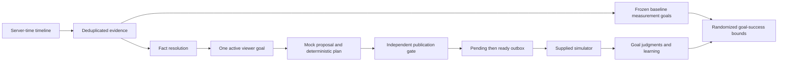

# How my project fits together

The core of my project is a Python CLI built with the standard library. I treat the supplied pack as input evidence and keep its text separate from application instructions. The replay runs sequentially so event ordering is reproducible. A separate benchmark uses process shards to measure bursts, and the website provides a local way to explore the results.

## Evidence and ownership

I merge events, control changes and triggers in server delivery order. Controls win timestamp ties, then evidence, then triggers. Historical records whose receipt is later than replay start remain in the timeline rather than leaking into preloaded history. Commitment-time snapshots require both `received_at` and `deliver_at` to be no later than that commitment. Device clock offset is never the ordering authority.

I keep each viewer's goal and action updates under one owner so those updates happen in order. SQLite enforces at most one open goal per user with a partial unique index. Raw event IDs, trigger IDs and deterministic action IDs provide idempotency, including reopening the database. A billing event can settle or invalidate a goal and select a replacement without emitting an unsolicited message.

| Fact | Resolution |
|---|---|
| Signup | Earliest arrived server-received signup, else the profile's signup field |
| Subscription | Valid latest profile; newer billing receipts override it; an expired profile plan downgrades only that profile's own status |
| Consent | Positive profile Boolean, with explicit opt-out sticky because no opt-in event is defined |
| Dialect | Latest arrived app-setting evidence; profile fallback; campaign links cannot override it |
| Series progress | Catalogue/episode structure and observed play/completion evidence; latest play is selected by server receipt, not insertion order |

I retain each fact's value, source references, evidence times, freshness and conflicts so I can trace a decision back to its inputs. Profiles are selected by latest valid `updated_at`, with deterministic snapshot/line tie breaks. Thirty days of observations cannot establish lifetime absence; that assumption is recorded.

## Planning and verification

I express goal rules as explicit predicates in code. G06 interprets recent lapse as 30 days. G09 counts IST days. G10 has no defined success predicate and G11's TV event is unavailable; neither is selected. Every goal has a committed start, deadline, rule version and success signal.

I give the mock model a candidate and evidence references. Catalogue descriptions and search/deeplink text stay outside its instruction boundary. Named fixture outputs are untrusted. Eligibility and evidence are independently checked at commitment; the model cannot manufacture a billing fact or a competing active goal. Faults can lead to deterministic fallback, but the publication gate still applies.

For a page, my planner selects a hero relevant to the goal and rows whose genre labels are supported by each title's catalogue genres. It respects dialect, availability and content-slug uniqueness across hero and rows. Non-subscribers get non-premium candidates. The separate verifier checks goal eligibility, holdout, duplicates, row shape/semantics, dialect and availability again at measured release time.

## Durable publication and actual storage failures

`Store.publish` stages the decision and optional action with `publication_state=pending`. After measured-time revalidation, `Store.release` commits their ready state. Ledger exports and local serving ignore pending entries. A process interruption before release is recovered as an abstention on reopening; it cannot expose an unchecked staged page.

`Engine.decide` catches actual SQLite and operating-system I/O exceptions across reads, ingestion, planning persistence and release. It rolls back, restores that viewer's in-memory snapshot, closes publication in the current engine instance, and writes an idempotent no-action decision to a separate JSON journal using flush, fsync and atomic replacement. Journal decisions survive reopening and supersede any interrupted primary outbox entry. If both stores fail, the error is visible rather than misreported as durable. A fresh replay is required after a genuine primary failure; control-cursor resume is not implemented.

I use decision timestamps to mark the final release request. `latency_observations.jsonl` separately measures method entry through completion of the final durable release, and the latency report uses that full value. This separates a transaction's assigned business timestamp from observed commit completion without losing the latter.

## Withdrawals

Withdrawal controls update availability, identify affected live pages, persist revocations, and attempt verified replacements for viewers with active plans. `current_page` rejects revoked or expired pages immediately; if no replacement is valid, it returns no personalized page so serving uses the platform default. Reopening the ledger preserves the revoked flags.

I kept the provided simulator unchanged. It understands valid replacement pages but has no pure revocation API. Tests validate the local serving contract, including the no-valid-replacement case. Production integration still needs an adapter for revocation acknowledgements and cache invalidation.

## Time, failures and scale

The provider and logical tools have configurable budgets, default 8 and 20. Provider 503s, malformed output, unsupported claims and timeout fixtures are bounded and fail safely. The named 45-second mock timeout is cancelled at 20ms. The degraded 8-second store fixture opens a conservative whole-window circuit. Actual SQL read/write failures are tested separately.

`load_test.py` queues a configurable burst at once and hashes viewers into isolated process shards, so a viewer is owned by one worker. Each shard has its own SQLite writer. Timings include process startup, pack loading, history ingestion, queue wait and durable release. The benchmark reports per-request observations, counts and deadline misses and fails if any selected request exceeds 60 seconds. It is not a shared-database, hosted-model, distributed-failover or ten-million-user claim.

## Measurement and learning

I keep adaptive goals separate from measurement goals so treatment cannot move the target used to evaluate it. Before the first intervention, `freeze_cohort` assigns a measurement goal to every randomized viewer using only already-arrived facts, with explicit no-goal cases. These goals do not change because treatment served or succeeded. Rule corrections apply only when a measurement goal was still open at correction time, using evidence available by that time.

Goal outcomes require attributable events inside committed windows: non-trial purchase for paid goals, the target slug for G07, release date for G08, and three IST dates for G09. Buffered evidence estimated to precede commitment is excluded. Incomplete windows and missing follow-up are inconclusive. Outcomes, evidence and conservative learning are saved to SQLite and per-viewer exports.

In the primary report, I retain every randomized user and show results by baseline goal. Because the simulator follows triggered users only, full-population point estimates are not identified. The report shows observed success/failure/inconclusive counts, worst-case missing-outcome bounds and a sampling envelope using Newcombe/Wilson limits at both extremes. Baseline eligibility is established before treatment; it is not served-only selection. Secondary recorded-completion contrasts have their coverage caveat. Pilot ITT uses randomized assignment and retains unserved treatment viewers.

## Local website

I start the local website with `serve.py`, which binds a Python HTTP server to the loopback address. `web/index.html`, `web/style.css` and `web/app.js` provide the responsive frontend without a Node build or external assets. The authenticated API reads completed artifacts through a bounded run cache, rather than inventing dashboard metrics. All chart and viewer data come from the selected run.

`web_auth.py` keeps local accounts separate from the synthetic viewer ledger: salted PBKDF2-SHA256 password hashes, opaque cookie sessions stored as hashes, per-session CSRF tokens, expiry, sign-out and revocation of other sessions. Browser cookies are HTTP-only and SameSite=Lax. State-changing requests require JSON, a trusted local origin, and a CSRF token after authentication. Password changes revoke other sessions. The site does not implement email verification or password-reset delivery.

The replay studio creates a background subprocess with fixed argument lists and a validated seed. Each job has an account owner and private output directory. Result access and cancellation check that owner. One job is active at a time in a server instance. A completed state requires the original CLI and independent audit to pass; partial outputs are not exposed as completed runs. The shared included sample is available to all signed-in local accounts.

I keep runtime accounts, hashed credentials, sessions, private jobs and logs under `.local/web/`, which Git ignores. The website is a development adapter, not a production HTTP/authentication/worker deployment. Its setup and limitations are documented in `docs/LOCAL_SETUP.md`.
