# Architecture

The runtime is an offline, single-process lifecycle agent. The CLI merges historical events, live events, controls and triggers into one ordered timeline. Control events win ties, then evidence events, then triggers. No future replay event is used before delivery. Events with a future historical `received_at` are also ingested at their actual receipt time, rather than preloaded as known facts.

```mermaid
flowchart LR
    A[Server-time replay] --> B[Deduplicated evidence ledger]
    B --> C[Fact resolver]
    C --> D[Viewer goal and plan]
    D --> E[Local model proposal]
    E --> F[Independent evidence and policy checks]
    F --> G[SQLite decision and action outbox]
    G --> H[Supplied simulator]
    H --> I[Outcome predicates and learning]
    I --> J[Randomized-arm report]
```

## Ownership and memory

The engine serializes all work for a viewer ID. `Store.goals` contains historical goal instances; exactly one can be open per viewer, also enforced by a partial unique SQLite index. An active goal is retained across triggers. Incoming success signals close it. Billing changes settle or invalidate it and immediately select a replacement when evidence permits, without sending an unsolicited action. Every decision retains its original goal snapshot.

Raw events are durable and unique on `event_id`. Decisions are unique on trigger ID and actions on deterministic action ID. Repeating a trigger, including after reopening SQLite, returns the stored decision. Initial decision/action publication is transactional. The subsequent timestamp refinement is a local outbox update; see crash-boundary limitations. CLI reruns use a new output directory instead of mixing independent experiments.

## Fact precedence and freshness

| Fact | Resolution | Action restriction |
|---|---|---|
| Signup | Earliest observed server-received signup event, else profile signup field | Cannot infer newness without either |
| Subscription | Latest valid profile version; billing receipts after its `updated_at` override it | Subscription-dependent goal requires evidence within 48h; known paid history blocks G05 |
| Expiry | Profile plan end downgrades its own active/trial status after expiry | Never reuse old plan end to override a newer billing receipt |
| Consent | Profile Boolean; observed explicit opt-out is sticky because no opt-in event is defined | Messaging gate additionally requires positive evidence within 48h |
| Dialect | Latest arrived app setting, profile fallback; campaign link has no authority | Missing or inconsistent dialect blocks publication |
| History | Only deduplicated events received by the decision time | Absence is limited to the supplied 30-day observation window |

Every resolved fact stores a value, source reference, server/evidence time and age. Overwritten conflicting values remain in a separate conflict list. Duplicate profiles are selected by `updated_at`, then `snapshot_at`, then file-line reference for deterministic ties; future snapshots are excluded.

A device timestamp is not an ordering authority. Trigger buffering is estimated from `sent_at - occurred_at`, cancelling a common clock offset, plus server queue delay. More than 600 seconds means abstention. This matches the supplied simulator's buffering convention. It cannot correct a phone clock that changes between event creation and send.

## Planning and trust boundaries

Goal predicates are explicit code over pack evidence. G01/G03 favor early activation; G04 trial conversion; G07 a series with uncompleted episodes; G02 first completion; then lapsed/habit/release/paid/return goals. G06's "recent" is 30 days; G09 day boundaries are IST. G10 has no defined predicate; G11 has no observable signal. Both are rejected.

The model sees only a precomputed goal candidate/evidence list. Descriptions, search queries and deeplinks never become instructions. The local provider reproduces specified faults; it makes no hosted calls. `verify_proposal` recomputes eligibility at goal commitment and rejects unsupported evidence or a competing goal. A rejected model claim may be replaced by a deterministic candidate, but it cannot grant eligibility.

The page planner proposes available content in the app dialect, deduplicated across hero and rows by content slug. Non-subscribers get non-premium choices. The independent action gate recomputes eligibility at commitment and checks current dialect, availability, row shape, slug uniqueness, holdout and duplicate publication. Availability is checked again using measured publication time. It can reject the planner. A daily outbound messaging safety gate exists for tests but messaging generation is not enabled.

## Timeouts and recovery

Model calls and logical data-tool calls are configurable per decision, default 8 and 20. Local normal runs use one model call and at most two logical tools. Tool counts are API-level operations, not every Python lookup or SQLite statement. Model 503s, malformed JSON and unsupported claims fall back to verified deterministic planning. A named 45s model fault is cancelled at the local mock's 20ms timeout. The named degraded 8s datastore read is rejected by a fail-fast circuit throughout its configured window; it does not pretend an 8s call completed instantly. No stale-cache publication occurs during that window.

Replay is accelerated and single-worker. Measured processing includes initial ledger commit. It is not a production p95 queueing or throughput benchmark. A production design needs per-viewer routing, bounded queues, a real provider adapter, deadlines propagated to I/O, and an external durable publication worker.

## Outcomes and causal measurement

Goal success requires a matching event received within its committed window; estimated buffering that places behavior before commitment excludes it. G03 requires a later IST date; G04-G06 require an explicit non-trial purchase; G07 requires its target slug; G08 uses releases in the preceding 30 days; G09 needs three distinct IST days. No evidence after a goal's deadline counts. A horizon ending before its deadline yields inconclusive. Invalidated goals are censored at their close time.

A correction updates only currently open instances of the named goal; settled instances and unrelated viewers keep their rules. New instances use the corrected version. Rule versions and affected IDs are audited. Future simulator outcomes are for judging and exported learning only, never retroactively used by replay planning.

The primary report fixes a seven-day recorded-completion endpoint, then compares all randomized arms including abstentions. A triggered-viewer subset and baseline first-goal descriptive contrasts are also shown. Confidence intervals use Newcombe differences of Wilson limits. Untriggered users have no simulator follow-up: the primary full-assignment estimate measures recorded outcomes in this synthetic observation process, not actual unobserved viewing. Pilot ITT joins randomized assignment to outcomes and retains unserved treatment viewers.
