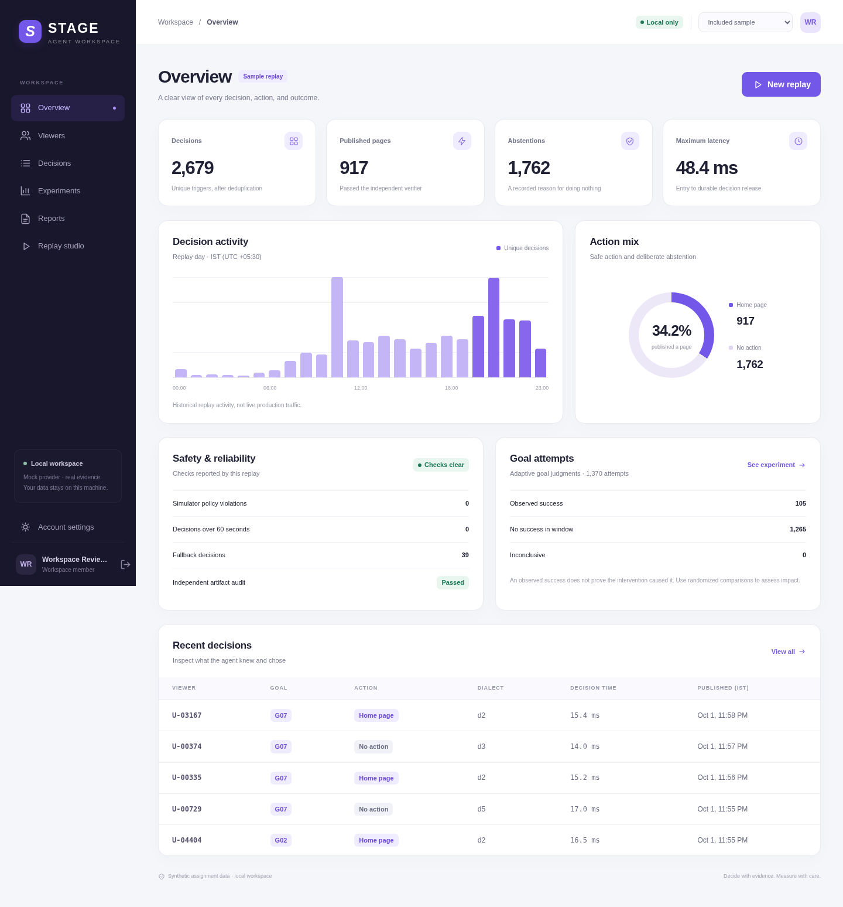
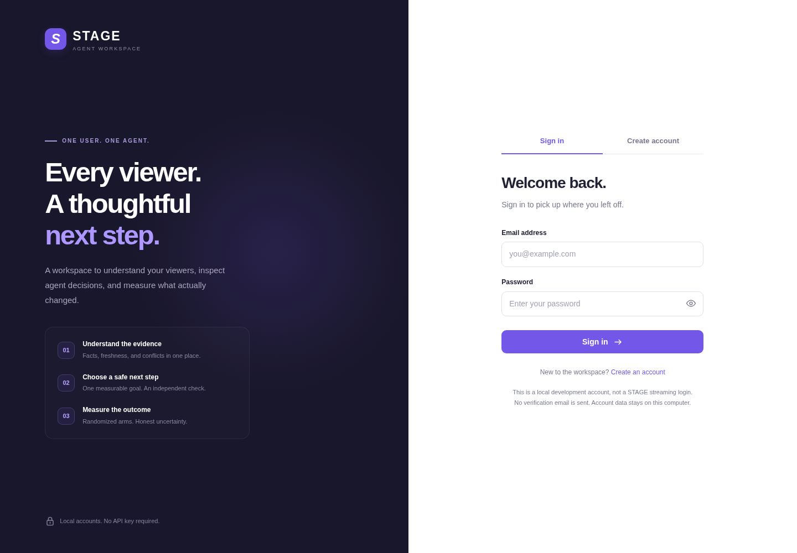

# STAGE — One User, One Agent

This is my submission for the STAGE One User, One Agent assessment. The idea is to give each viewer one active goal, make decisions from traceable evidence, and check what happened afterward. I use a chronological replay, SQLite state, a separate verifier and randomized comparisons to make that process inspectable. An included sample run lets me walk through the results.

I kept the intervention scope to **a home page or an explicit decision to take no action**. The provider is a local mock. My [known limitations](KNOWN_LIMITATIONS.md) explain what still needs work, and [my collaboration notes](AI_COLLABORATION.md) describe the substantial Codex assistance behind the project.

## Start the website

I use the website to explore the replay without opening every output file by hand. It includes sign-up and sign-in, a dashboard, viewer and decision explorers, experiment results, report downloads, account settings and a replay studio.

```bash
python serve.py
```

Open **http://127.0.0.1:8000**, select **Create account**, and sign in with your own local account. The included sample works immediately; the original data pack is needed only to run new replays. No npm, pip install, external database or model key is required.

**Follow [LOCAL_SETUP.md](docs/LOCAL_SETUP.md) for complete Windows instructions, data-pack placement, troubleshooting, and the website workflow.**

<details>
<summary>Preview the website</summary>





</details>

## Run on Windows, macOS or Linux

I use Python 3.10 or newer. The application runs with the standard library, so there are no third-party runtime dependencies or API keys to configure.

1. Download/clone this repository.
2. Extract the assignment ZIP privately. Rename its inner `one_user_one_agent_pack` directory to `data_pack` and put it beside `run.py`.
3. Verify that `data_pack/data/catalogue.csv` exists. There must not be another enclosing pack directory between `data_pack/` and `data/`.
4. Run from the repository root:

```bash
python -m unittest discover -s tests -v
python run.py --pack data_pack --out practice_run
python audit_run.py --pack data_pack --run practice_run
```

The second command runs my full pipeline: evidence ingestion → replay → unchanged supplied simulator → goal judgments → impact and latency reports. Use a new output directory for each run. I keep `sample_run/` as a reference from a completed run and use a fresh output directory for new runs.

For a different seed:

```bash
python run.py --pack data_pack --out practice_run_seed2 --seed alternate
```

For a 1,000-request burst benchmark with four process shards:

```bash
python load_test.py --pack data_pack --out load_run --requests 1000 --workers 4
```

My benchmark queues all requests together. Reported end-to-end time includes process startup, pack loading, history ingestion, queue wait and durable release. Viewer hashing preserves one owner per viewer. This uses local SQLite per shard and a mock provider; it is not a production shared-database benchmark.

## How I navigate the code

- [Step-by-step guide](docs/STEP_BY_STEP.md): files, behavior, implementation choices and practice questions.
- [Architecture](ARCHITECTURE.md): ownership, trust boundaries, failure recovery and measurement.
- [Technical discussion notes](docs/TECHNICAL_DISCUSSION.md): defensible answers and a real viewer trace.
- [Review exercises](docs/OWNER_REVIEW.md): my completed checks and next review steps.
- [Validation](docs/VALIDATION.md): commands, evidence and limits.
- [Website validation](docs/WEBSITE_VALIDATION.md): authentication, API, browser and replay checks.
- [AI collaboration](AI_COLLABORATION.md): actual assistance and review history.

```text
run.py / audit_run.py / load_test.py
src/stage_agent/
  common.py       time and file helpers
  data.py         pack loading, profile versions and catalogue availability
  facts.py        source-specific precedence, freshness and conflicts
  goals.py        eligibility, deadlines, rule corrections and outcome predicates
  planner.py      goal-relevant hero and catalogue-backed genre rows
  verifier.py     independent evidence and publication gates
  provider.py     mock faults and configurable call budgets
  store.py        SQLite ledger and pending/ready publication states
  recovery.py     independent durable abstention journal
  engine.py       viewer lifecycle, safe failures, revocation and rebuilding
  cohort.py       pre-intervention measurement goals and missing-outcome bounds
  reports.py      judgments, randomized comparisons and pilot correction
  cli.py          full pipeline orchestration
 tests/           behavioral and regression tests
 sample_run/      decisions, actions, states, judgments, audits and reports
```

## How I interpret the results

For the primary report, I compare **baseline-goal success by randomized arm**. I keep measurement goals fixed from before the first intervention and separate from the goals the agent adapts during replay. Every randomized viewer stays in the report. Missing follow-up and undefined/unavailable goals are inconclusive; they are not silently counted as failures. Full-population goal-success point estimates are not identified from this pack, so the report supplies bounds and a sampling envelope, plus goal-specific results. A seven-day recorded-completion endpoint remains a secondary metric with its observation limitations stated.

I treat an individual success as an observed outcome. To assess whether an intervention helped, I need the randomized comparison. The pilot re-analysis shows how comparing served and unserved viewers can give a misleading result.

## Important output files

`decisions.jsonl`, `actions.jsonl`, `viewer_state/`, `outcomes.jsonl`, `cohort_outcomes.jsonl`, `revocations.jsonl`, `audit.jsonl`, `latency_report.json`, `latency_observations.jsonl`, `impact_report.md`, `impact_metrics.json`, `artifact_audit.json`, `final_report.md`, and `sim/`.

I keep SQLite files, recovery journals and the original data pack out of Git. To rerun the full pipeline, I need the supplied ZIP. The included simulator events still let me check the sample outcome evidence without a database file.
